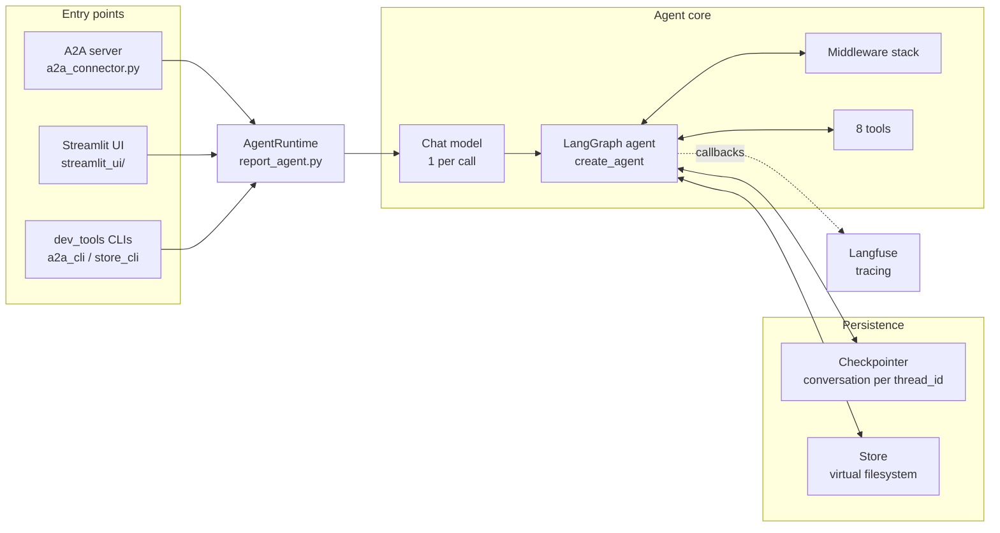
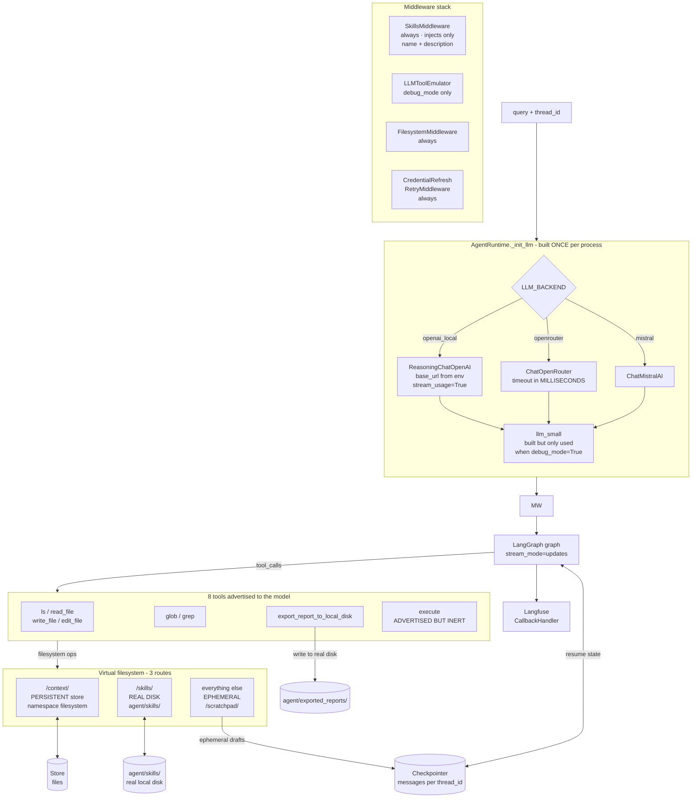
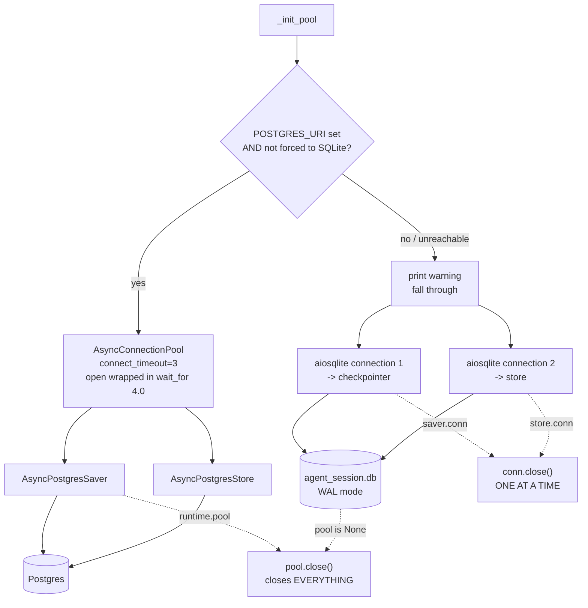
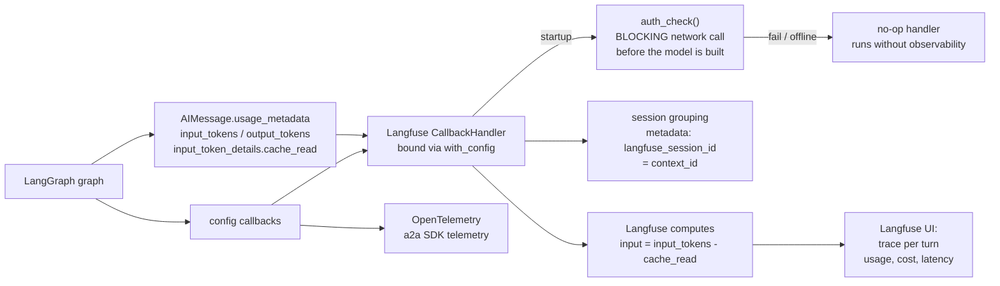

# Architecture

One agent, two independent consumers. That is the whole shape of the system,
and most confusion about it comes from expecting the two consumers to share
anything.

```
                    ┌──────────────────────────────────────────┐
                    │  AgentRuntime  (agent/report_agent.py)  │
                    │                                          │
                    │  models · middleware · checkpointer      │
                    │  store · graph · tool                    │
                    └────────────────────┬─────────────────────┘
                                         │
              ┌──────────────────────────┴──────────────────────────┐
              │                                                     │
   ┌──────────▼───────────────────────┐             ┌───────────────▼───────────────┐
   │  A2A surface                     │             │  Streamlit surface            │
   │                                  │             │                               │
   │  agent/a2a_connector.py          │             │  streamlit_ui/__main__.py     │
   │    ReportA2AExecutor             │             │    flags -> env vars          │
   │      one task = one run          │             │  streamlit_ui/app.py          │
   │      global_execution_lock       │             │    render                     │
   │                                  │             │  services/interfaces.py       │
   │  client/a2a_client.py            │             │    three Protocols            │
   │    A2AClient — full lifecycle    │             │  services/agent_service.py    │
   │                                  │             │    business logic             │
   │  dev_tools/a2a_cli.py            │             │  services/real_backend.py     │
   │    thin CLI over the client      │             │    real adapters + async      │
   │                                  │             │  components/                  │
   └──────────────────────────────────┘             │    chat, upload, download     │
                                                 └───────────────────────────────┘
```

The two surfaces share **only** `AgentRuntime`. They do not share transport,
state, session identity, or a persistence convention — which is deliberate, and
is why either can be developed, broken, or removed without touching the other.

The same shape again, showing what each surface reaches for on its way through:



Cite symbols rather than line numbers in this file. Line numbers rot on every
edit above them, and they are the main reason this document was wrong for months.

---

## The core: `AgentRuntime`

`agent/report_agent.py`. Owns every heavy resource. A module-level singleton
`runtime = AgentRuntime()` at the bottom of the file is what both surfaces reach
for.

All construction happens in `initialize()`, never at import, so importing the
module is free and side-effect-free. `tests/acceptance/5_report_agent_structure.py`
asserts that.

| Method | Owns |
|---|---|
| `_init_llm` | The **only** place a chat model is constructed. Backend selection, per-backend defaults, credential handling. |
| `_init_middleware` | The middleware stack, assembled in order. |
| `_init_pool` | Checkpointer + store. Postgres if reachable, SQLite otherwise. |
| `_create_agent` | Compiles the LangGraph agent via `create_agent`. |
| `_reload_llm_credential` | Re-reads the API key after an auth failure and patches the live clients. |

One turn, end to end:



`execute` is worth a note, because it is advertised and cannot work.
`FilesystemMiddleware` lists it among its tools, but `CompositeBackend.execute()`
delegates to whatever the *default* backend is and raises `NotImplementedError`
unless that backend implements `SandboxBackendProtocol` — ours is `StateBackend`,
which does not. So the model can call it and will always get
`Default backend doesn't support command execution (SandboxBackendProtocol)`.

That is a wasted turn today, and a latent capability tomorrow: the moment
someone routes a sandbox backend in as the default, the agent silently gains
shell execution with no code change and no review. Worth a guard before that
happens rather than after.

### Model selection

`LLM_BACKEND` picks one of three:

| Backend | Class | Notes |
|---|---|---|
| `openai_local` | `ReasoningChatOpenAI` | Subclasses `ChatOpenAI` to keep `reasoning_content`, which the stock class drops — see Traps. `stream_usage=True` is required here. |
| `openrouter` | `ChatOpenRouter` | **Timeout is milliseconds**, not seconds. Already extracts reasoning itself; it does **not** subclass `ChatOpenAI`. |
| `mistral` | `ChatMistralAI` | Self-reads `MISTRAL_API_KEY`. |

Left unset, the backend is inferred: `LLM_BASE_URL` → `openai_local`,
`OPENROUTER` → `openrouter`, else `mistral`.

Model ids come from `AGENT_MODEL` / `AGENT_EMULATOR_MODEL`, which are
**backend-agnostic** — one pair of names for all three backends. Each falls back
to `_BACKEND_MODEL_DEFAULTS[backend]`, so switching `LLM_BACKEND` switches the
default model with no other edit. There is no per-backend model variable; an
earlier `LLM_MODEL` was deleted for exactly that reason.

A stale override from another backend is caught at startup and the default is
used instead. The check is deliberately narrow — only OpenRouter, only "id
contains no `/`" — because that is the one signal that reliably identifies a
leftover. A mismatch the heuristic cannot see is left to the provider.

### Middleware stack

Assembled in `_init_middleware`, in this order:

1. **`SkillsMiddleware`** (always) — injects the skill library's `name` +
   `description` into the system message. Progressive disclosure: the workflow
   body is not in the prompt, the agent pulls it with `read_file` on
   `/skills/<name>/SKILL.md` when it decides the skill applies.
2. **`FilesystemMiddleware`** (always) — backs the virtual filesystem.
3. **`LLMToolEmulator`** (only when `debug_mode=True`) — intercepts
   `export_report_to_local_disk` and answers it from `llm_small`.
4. **`CredentialRefreshRetryMiddleware`** (always) — see below.

Skills are gated by their `description`, not by the system prompt: a skill that
says "skip for small reports" is skipped, and the agent is expected to say so
rather than load it. `agent/reports.md` carries only a pointer to the skill, not
the workflow it holds.

#### `CredentialRefreshRetryMiddleware`

A subclass of LangChain's `ModelRetryMiddleware`. On an auth failure it re-reads
the credential from the `.env` **file** and, if it changed, retries immediately
in the same attempt slot. Otherwise the parent's retry schedule runs untouched.

Two details that are load-bearing:

- The credential is patched onto the **live clients**, never rebuilt. `create_agent`
  binds the model at compile time, so a new `ChatOpenAI` would be an object the
  graph never calls. Both `root_client` and `root_async_client` are updated —
  the agent is async end to end, so updating only the sync one changes nothing
  at runtime.
- `on_failure='error'`, not `'raise'`. Only `'error'` re-raises; any other value
  formats the failure into a `ModelResponse` holding an `AIMessage`, so a dead
  key reaches the agent as a model-authored error string instead of an exception.

#### Rate limiting — present but not wired

`InMemoryRateLimiter` is constructed in `_init_middleware` and **not** passed to
any model; all three branches of `_init_llm` pass `rate_limiter=None`.

This is deliberate, not an oversight. Rate limiting was a separate piece of work
whose purpose was the Mistral backend, which needs request pacing. The local
model server and OpenRouter do not. The limiter is left in the code so it can be
re-enabled per backend without re-deriving it — `ChatMistralAI` is the case that
would need it.

If you are reading this wondering whether to delete it: don't, and if you wire
it up, wire it per backend rather than globally.

### Storage

`_init_pool` tries Postgres and falls back to local SQLite
(`agent/agent_session.db`). The connect timeout is deliberately tiny
(`connect_timeout=3`, pool open wrapped in a 4s `wait_for`) so an unreachable
database degrades fast instead of hanging boot.



**The two backends are not symmetric at shutdown**, and that is the trap here.
On Postgres there is one object to close and closing it is sufficient. On SQLite
there are two independent `aiosqlite` connections, and each owns a **non-daemon**
worker thread parked in `while True: tx.get()`, which only exits when its
connection object is finalised. Close neither and the interpreter blocks forever
in `threading._shutdown()` waiting on their thread sentinels — after uvicorn has
already printed `Finished server process` and released the port, so the process
looks hung and Ctrl-C does nothing, because there is no application code left to
interrupt.

`dev_tools/store_cli.py` has always closed these two connections for exactly this
reason. The A2A lifespan did not, which is why `agent/a2a_connector.py` now tears
down each connection individually.

Two namespaces matter:

- **`""`** — owned by the agent. Its conversation state.
- **`"ui"`** — owned by the Streamlit surface, under a fixed checkpoint id and
  metadata `{"source": "ui"}`, for display history only.

Writing UI rows into `""` destroys the agent's own state. This is the single
most destructive mistake available in the codebase.

The virtual filesystem is a `CompositeBackend` with three routes, so one
filesystem tool serves three different stores:

| Path | Backend | Holds |
|---|---|---|
| `/context/` | store-backed, `("filesystem",)` | templates, guides, findings, compiled reports |
| `/skills/` | real disk (`agent/skills/`) | `SKILL.md` files |
| everything else | in-memory, per session | the `/scratchpad/` drafts |

Route matching strips the prefix before the store lookup, so the agent's
`/context/findings/x.txt` is the store key `/findings/x.txt`. That is why
`dev_tools/store_cli.py seed --dir <dir>` produces keys relative to `<dir>`: seed
a directory that *contains* `findings/` and the keys line up with what the agent
asks for.

### Tools

- Filesystem tools (`ls`, `read_file`, `write_file`) come from
  `FilesystemMiddleware`, not from hand-written definitions.
- `export_report_to_local_disk` is the one real tool, defined in
  `report_agent.py`. It pulls a compiled report out of the store onto local disk.
- Skills are files on disk, reached through the same `read_file` tool at
  `/skills/<name>/SKILL.md`. Editing a `SKILL.md` changes agent behaviour with no
  code change and no restart.

### Observability

Langfuse, via `langchain.CallbackHandler`, bound once at build time with
`self.agent.with_config(...)`. Because `with_config` bindings **merge** with
per-invocation config rather than replacing it, the handler coexists with the
per-call metadata each surface supplies. Unreachable Langfuse degrades to a no-op
handler rather than failing startup.

Token counts require `stream_usage=True` on the `ChatOpenAI` branch only. The
OpenRouter and Mistral branches do not request usage, so their generations report
no token counts.



Three things worth being candid about:

- **Grouping a turn into one session depends on one metadata key.** `session.id`
  is not recognised by the handler, so using it silently yields one trace per
  model call. `langfuse_session_id` is the key that works.
- **`auth_check()` is a blocking network call at startup**, before the model is
  even constructed, so an unreachable Langfuse adds latency to boot rather than
  failing it.
- **`input` in Langfuse is net of cached prompt tokens.** With heavy prompt
  caching the raw `input_tokens` badly overstates cost; the handler already
  subtracts for you, so cost math does not need to correct for it.

---

## Surface 1: A2A

Three layers, each independently usable.

```
client/a2a_client.py    A2AClient — the whole task lifecycle
        ↑
agent/a2a_connector.py  the server; does not import the client
dev_tools/a2a_cli.py    CLI over the client
```

The server and the client never import each other. The CLI imports only the
client. That is what lets the server be exercised by a test client and the client
be exercised by a test server.

### Server

`agent/a2a_connector.py`. `ReportA2AExecutor` turns one A2A task into one agent
invocation.

- **`global_execution_lock`** serialises every task, with a keep-alive loop. One
  agent run at a time, whatever the client asks for.
- **`_process_task`** builds the run config. Two things in it are load-bearing:
  `thread_id = task.context_id`, which is what makes conversation memory work
  across turns, and `metadata["langfuse_session_id"]`, which is what makes all
  turns of a thread land in one Langfuse session.
- **`_consume_agent_stream`** streams node diffs and, on a dropped Postgres
  connection, heals the pool once and resumes the **same thread** — LangGraph
  continues from its last checkpoint instead of failing the run.

#### Binding

Loopback by default. The bind address and the URL advertised in the agent card
must agree, because the client sends every JSON-RPC call to the URL *in the card*
rather than to the address it was pointed at. A mismatch produces a server whose
card fetch works and whose every subsequent call is refused.

| Control | Effect |
|---|---|
| `--host local` | Binds `127.0.0.1`. The default. Not reachable from LAN or tailnet. |
| `--host all_interfaces` | Binds `0.0.0.0`. Reachable from LAN and tailnet, and survives a Wi-Fi IP change. |
| `A2A_BIND` | Escape hatch for one specific address. Stops surviving an IP change. |

`A2A_HOST` is *not* a bind control. It only overrides the IP advertised in the
agent card under `all_interfaces`.

There is no authentication either way.

### Client

`client/a2a_client.py`. `A2AClient` covers the full lifecycle:
`send_message`, `send_streaming_message`, `subscribe_to_task`, `get_task`,
`list_tasks`, `cancel_task`, `poll_until_complete`.

It is careful about one protocol detail: `send_message` uses a dedicated
**non-streaming** client, because the true A2A `send` is not a streaming call.
Getting that wrong is easy and looks like a server bug.

### CLI

`dev_tools/a2a_cli.py`, one subcommand per client method. Exit codes are
meaningful: `0` ok, `1` a protocol error reported by the server as one
`[server] <ErrorType>: <message>` line, `2` argparse usage, `130` Ctrl-C — which
prints that the client disconnected and **the server keeps working**.

---

## Surface 2: Streamlit

```
__main__.py           flags -> env vars, then delegates to streamlit.web.cli
app.py                rendering and session lifecycle
services/
  interfaces.py       three Protocols: checkpointer, file store, agent runner
  agent_service.py    business logic over the three injected deps
  real_backend.py     real adapters + the sync->async bridge
components/           chat display, file uploader, report downloader
```

Everything the UI needs is behind the three Protocols in `interfaces.py`. That is
what lets `tests/mock/mock_objects_streamlit.py` satisfy them and let the whole
UI run with no services — note that **production code imports from `tests/`** for
the mock implementations, which is unusual and load-bearing.

### The sync/async bridge

Streamlit scripts are synchronous; LangGraph is async. `EventLoopThread`
(`real_backend.py`) owns a private event loop for the life of the process, and
every async call crosses it. Never await directly from UI code.

### Streaming the agent run

`RealAgentRunnerAdapter.run` is a **generator**. It schedules the agent stream on
the event loop, pushes parsed events into a queue, and yields them to the
synchronous caller.

It cancels the agent stream when the generator is abandoned, which is what
Streamlit's Stop button does. Cancelling the `concurrent.futures.Future` returned
by `schedule()` propagates to the underlying `asyncio` task even after the
coroutine has started (verified on 3.11), so a `try/finally` around the yield loop
is enough to stop work in flight.

A cancelled run deliberately does **not** emit a final message or fall back to
the checkpointer. Doing either would write state for a turn the user stopped,
which then appears in the session list as a half-finished entry.

### Three agent modes

| Mode | Persistence | Agent |
|---|---|---|
| `--agent real` | real | real LangGraph |
| `--agent mock` | real | scripted `MockAgentRunner` |
| `--agent mocks` | in-memory | scripted |

Modes are sticky: flags write env vars at startup and the choice is fixed for the
life of the process. You cannot switch backend or agent mid-run.

---

## Invariants

Breaking one of these loses data silently rather than loudly.

1. **One model factory.** Every production chat model is constructed in
   `AgentRuntime._init_llm`. Nothing else builds one.
2. **The agent owns checkpoint namespace `""`.** The UI owns `"ui"`. See Storage.
3. **Store keys are slash-prefixed.** Virtual filesystem entries live in namespace
   `("filesystem",)` with keys like `/findings/nmap.txt` and values shaped
   `{"content": str, "encoding": "utf-8"}`. The UI and the agent must agree
   exactly or uploads become invisible to the agent.
4. **Sync UI, async agent.** Everything crosses `EventLoopThread`.
5. **Sessions are created on first message, not on page load.** Deliberate — it
   keeps empty and interrupted sessions out of the selector.
6. **Checkpoint blob versions must strictly increase** per
   `(thread_id, checkpoint_ns, channel)`. The upsert is `ON CONFLICT DO NOTHING`,
   so reusing a version silently keeps the old blob. Derive the next version from
   the current checkpoint's `channel_versions`; a per-instance counter resets and
   collides.

---

## Traps

Each of these cost real debugging time and is not obvious from the code.

- **`ChatOpenRouter` takes its timeout in milliseconds**; `_init_llm` multiplies
  by 1000. That looks like a bug and is not.
- **`ChatOpenAI` silently discards `reasoning_content`**, so the local backend
  uses `ReasoningChatOpenAI`. Its SSE delta reader is written against the OpenAI
  API spec and picks out five keys — `id`, `role`, `content`, `function_call`,
  `tool_calls` — and a llama.cpp `reasoning_content` delta is none of them.
  `ChatOpenRouter` is the counter-example that makes this confusing: it is *not*
  a `ChatOpenAI` subclass (it derives from `BaseChatModel` and has its own delta
  reader) and already extracts the field. Two classes, same name, different
  behaviour. There is no constructor flag for this — it has to be a subclass.
- **`stream_usage` must be explicit on `ChatOpenAI`.** `langchain-openai` only
  auto-enables it for the default OpenAI base URL. Because this repo always passes
  an explicit `base_url`, the flag stays off, no `stream_options` is sent, and
  every generation reports zero tokens.
- **`stream_mode=["messages", "updates"]` needs `version="v2"`.** Without it LangGraph
  multiplexes the two channels into naked `(mode, payload)` tuples, and a consumer
  that unpacks every 2-tuple as `(chunk, metadata)` drops both — including the tool
  calls that were arriving correctly. Pass `version="v2"` and dispatch on
  `part["type"]`. See `AGENTS.md` for the full trap, including why the v3
  `interleave()` API is not usable from async code.
- **`--no-streaming` / `STREAMLIT_STREAM=0` suppresses token and reasoning deltas** at
  the source. Tool calls and tool results still stream live, and prose still flushes
  into rows at segment boundaries — only the incremental prose is dropped.
- **Live text and reasoning are repainted from coalesced buffers**, not from the
  delta event log. `RunState` keeps `in_flight_text` and `in_flight_reasoning`, and
  the live fragment re-reads them on a timer. Streamlit repaints a fragment from
  scratch each tick, so rendering deltas directly would rebuild the same string every
  poll and produce one chat bubble per token. Both buffers clear when a segment
  flushes into the transcript.
- **Langfuse session grouping needs `config["metadata"]["langfuse_session_id"]`.**
  Not `configurable`, and not `session.id` — that key is silently ignored, which is
  why it looked broken for so long.
- **`list_threads` stays filtered** (`{"source": "ui"}`, `limit=1000`). An
  unfiltered `alist(None)` on Postgres de-blobs every checkpoint in every namespace
  and exceeded the bridge timeout, crashing the app at boot.
- **To force local SQLite use `REPORT_AGENT_FORCE_SQLITE=1`.** Unsetting
  `POSTGRES_URI` in the shell does not work — `load_dotenv` puts it right back.
- **On Windows** `report_agent.py`, `real_backend.py`, `a2a_connector.py` and
  `store_cli.py` all set `WindowsSelectorEventLoopPolicy`. Removing it breaks
  async Postgres on win32.

---

## Update this when

- a layer, entry point, or subprocess is added or removed
- the model factory, middleware stack, or storage layout changes shape
- the bind model, the two-consumer split, or the streaming approach changes
- an invariant is added, moved, or retired
- a new trap above is discovered

Not for: wording, feature descriptions, or anything already covered by
`.env.example` (which is the single source of truth for env vars) or
`docs/dependencies.md` (which owns the dependency list).